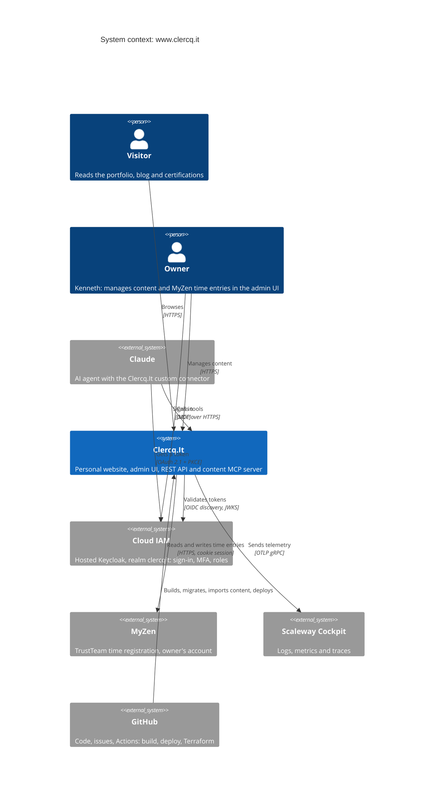
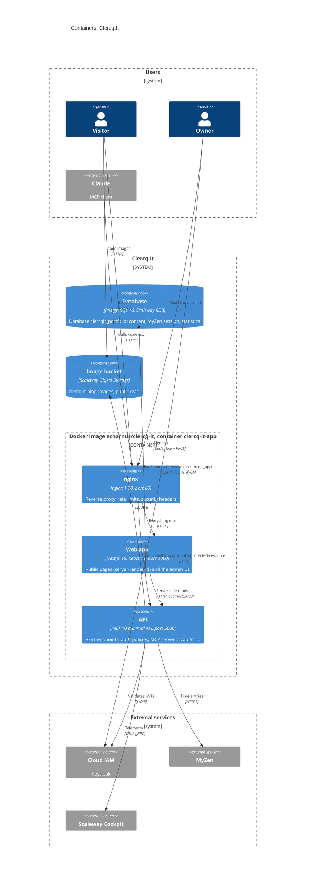
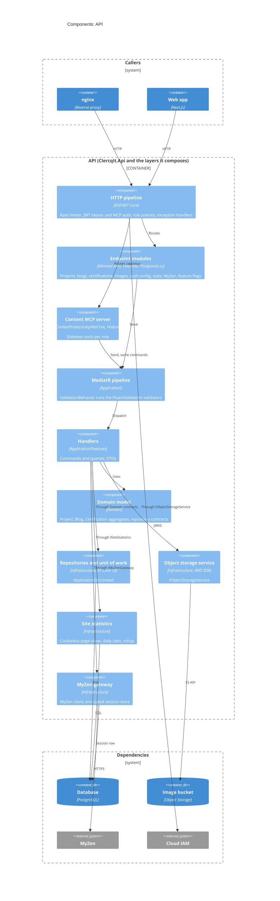
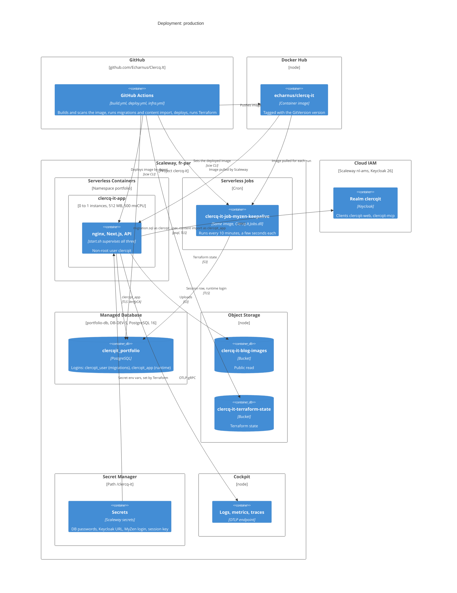
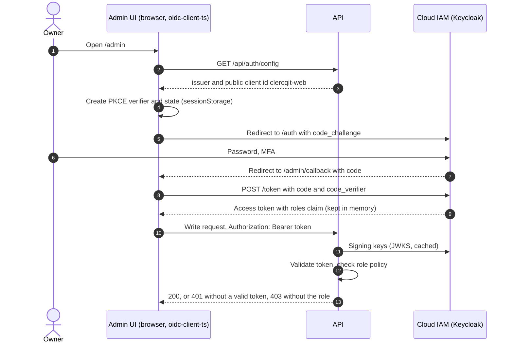
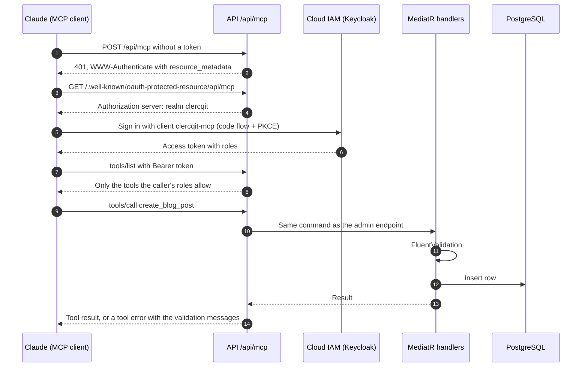

# Architecture Overview

This document provides a comprehensive overview of the Clercq.It application architecture, design principles, and technical implementation.

## Architecture Principles

The project follows **Clean Architecture** principles with **Domain-Driven Design (DDD)** to ensure:
- **Separation of Concerns**: Each layer has a distinct responsibility
- **Dependency Inversion**: Dependencies point inward toward the domain
- **Testability**: Business logic is isolated and easily testable
- **Maintainability**: Clear boundaries make the system easier to understand and modify

## C4 diagrams

These diagrams follow the [C4 model](https://c4model.com) and are written in [Mermaid](https://mermaid.js.org/syntax/c4.html), so GitHub renders them in place. They show production as it runs now; the code-level layers are under [Layer Structure](#layer-structure).

**Keep them current.** A PR that adds, removes or renames a container, an external system, a database login, an API component or a route group, or changes how sign-in or the MCP server works, updates the diagrams here in the same PR. Check that they still parse before you push (see [Rendering the diagrams locally](#rendering-the-diagrams-locally)).

### System context

Who uses the site and which outside systems it depends on.



### Containers

One Docker image (`src/Dockerfile`) runs nginx, the Next.js app and the API in a single Scaleway serverless container; see [Production Container Architecture](#production-container-architecture). The browser loads images straight from the public bucket. The API connects with the runtime login `clercqit_app`, which can read and write rows but not change the schema ([database logins](./secrets.md#database-logins)).



### Components of the API

Endpoint modules and the MCP tools never touch the DbContext: they send MediatR commands and queries, and the handlers reach Infrastructure through the contracts in Domain and Application. The architecture tests enforce this ([Architecture rules](#architecture-rules)).



### Deployment

What runs where in production. Terraform in `infra/terraform/` defines the Scaleway resources, except the container namespace `portfolio`, which it only reads. The deploy pipeline is described in [DevOps](./devops.md). The migration login `clercqit_user` is only used by `deploy.yml`; the admin login `clercqit_admin` is used by nothing. The verify environment is not shown: PR #446 removes it.



### Admin sign-in

The admin UI uses the authorization code flow with PKCE against Cloud IAM (`src/ClercqIt.Web/lib/auth.ts`, [Cloud IAM](./ciam.md)). The API never sees a password.



### Content MCP server call

How Claude finds the login, gets a token and calls a tool on `/api/mcp` ([MCP](./mcp.md)).



### Rendering the diagrams locally

GitHub renders the diagrams in a PR's file view, which is the quickest check. To check that every diagram parses from the command line, run mermaid-cli on this page:

```bash
npx -y @mermaid-js/mermaid-cli -i docs/architecture.md -o /tmp/architecture.md
```

It writes one SVG per diagram next to the output file and fails on a syntax error. mermaid-cli drives a headless Chromium through Puppeteer. Where Puppeteer cannot download one, as in Claude Code cloud sessions, point it at the installed browser with `-p puppeteer.json`, a file containing `{"executablePath": "/opt/pw-browsers/chromium-1243/chrome-linux64/chrome", "args": ["--no-sandbox"]}`. Mermaid's C4 layout is automatic: element order and `UpdateLayoutConfig` are the only levers, so group related elements in a `Boundary` to keep the picture readable.

## Layer Structure

Dependencies point inwards. Domain knows nothing about the other layers; the
Api and the tools (content import, scheduled jobs, migrations) are composition roots that wire Infrastructure in.

```
            ClercqIt.Api ─────────────┐
   (also: ContentImport, Jobs, EF.Migrations)│
              │                       │
              ▼                       ▼
        Application ◄──────── Infrastructure
   (MediatR, FluentValidation)  (EF Core, Npgsql, S3)
              │                       │
              └─────────► Domain ◄────┘
                (entities, value objects, repository contracts)
```

## Architecture rules

`tests/Clercq.It.Architecture.Tests` enforces these rules with
[NetArchTest](https://github.com/BenMorris/NetArchTest). It runs with the rest
of the suite in CI, so a violation fails the PR.

| Rule | Test |
|------|------|
| Domain depends on no other layer and no framework (EF Core, ASP.NET Core, Npgsql, MediatR, FluentValidation, AWS SDK) | `LayeringTests` |
| Application depends only on Domain, MediatR and FluentValidation | `LayeringTests` |
| Infrastructure does not depend on the Api | `LayeringTests` |
| Endpoint modules under `Clercq.It.Api.Features` go through MediatR, never the DbContext or repositories | `LayeringTests` |
| Only `ClercqIt.Api`, `Clercq.It.Infrastructure.EF.Migrations`, `Clercq.It.ContentImport` and `Clercq.It.Jobs` reference the Infrastructure project | `LayeringTests` |
| Aggregates (`IAggregateRoot`) live in `Clercq.It.Domain.Entities` and have no public setters (init is fine) | `DomainModelTests` |
| Value objects in `Clercq.It.Domain.ValueObjects` are records or sealed, without public setters | `DomainModelTests` |
| Repository contracts are interfaces in Domain, implemented in Infrastructure | `DomainModelTests` |
| MediatR requests end in `Command` or `Query`, handlers in `Handler`, validators in `Validator`, all in Application | `DomainModelTests` |

Aggregates change state only through their constructor, a `Create` factory and
behaviour methods (`Update`, `ChangeImage`, `Reschedule` on `Blog`, `Feature` and
`Unfeature` on `Project`), which enforce the invariants: a blog needs a short
description, a project a title and an end date on or after its start, and a
certification a title, an issuer and an expiry date on or after its issue date.
A violation throws `ArgumentException`; the Application validators reject the
same input earlier with a 400. EF Core loads rows through a private parameterless
constructor and private setters (#277). Tests build aggregates with the
`Aggregates` helper in `tests/Clercq.It.Application.Tests/Aggregates.cs`.

Run only these tests:

```bash
dotnet test tests/Clercq.It.Architecture.Tests -c Release
```

When a rule fails, the message lists the offending types. Fix the dependency
rather than the rule. If a rule is genuinely wrong, change it in the test and
in this table in the same PR.

## Layer Responsibilities

### Domain Layer (`src/Clercq.It.Domain`)

The core of the application containing business logic and domain models.

**Components:**
- **Entities**: `Project`, `Blog` and `Certification` aggregate roots
- **Value Objects**: `Skills` and `Tags` collections for complex domain concepts
- **Abstractions**: `IAggregateRoot`, `IRepository<T>`, `IUnitOfWork`, `IObjectStorageService`
- **Repository Interfaces**: `IProjectRepository`, `IBlogRepository`, `ICertificationRepository`

**Key Principles:**
- No dependencies on other layers
- Contains all business rules and domain logic
- Defines repository interfaces (implemented in Infrastructure)
- Uses value objects to encapsulate complex domain concepts

### Application Layer (`src/Clercq.It.Application`)

Orchestrates application workflows and use cases.

**Components:**
- **Features**: Organized by area (`Projects`, `Blogs`, `Certifications`, `MyZen`, `Statistics`)
- **Queries and commands**: list, get by id, create, update and delete for projects, blogs and certifications; image upload; MyZen session and time entries; page views and the statistics summary
- **Handlers**: MediatR query and command handlers implementing CQRS pattern
- **DTOs**: `ProjectDto`, `BlogDto`, `CertificationDto` and per-feature DTOs for data transfer
- **Validation**: FluentValidation validators run for every MediatR request through `ValidationBehavior` (Application/Common/Behaviors); a failure becomes a 400 validation problem via `ValidationExceptionHandler` in the API

**Key Principles:**
- Depends only on Domain layer
- Implements CQRS with MediatR
- Defines application-specific DTOs
- Contains validation logic for requests

### Infrastructure Layer (`src/Clercq.It.Infrastructure`)

Implements external concerns and data persistence.

**Components:**
- **DbContext**: `ApplicationDbContext` with PostgreSQL provider
- **Entity Configurations**: EF Core fluent mappings for domain entities
- **Repositories**: Generic `Repository<T>` and specific implementations
- **Unit of Work**: Transaction management and change tracking
- **Object Storage**: S3-compatible service for Scaleway Object Storage (blog images)
- **Statistics**: cookieless visitor statistics in PostgreSQL, daily salts and rollup (`Statistics/`, see [Visitor statistics](./statistics.md))
- **MyZen**: client for the owner's MyZen account and its encrypted session store (`MyZen/`, see [MyZen](./myzen.md))
- **Configuration**: Settings for object storage (`ObjectStorageSettings`)

**Key Principles:**
- Implements repository interfaces from Domain
- Handles database migrations and schema
- Contains EF Core configurations
- Manages external dependencies (database, file system, etc.)

### API Layer (`src/ClercqIt.Api`)

Exposes HTTP endpoints and handles web concerns.

**Components:**
- **Minimal APIs**: Feature-based endpoint organization (`src/ClercqIt.Api/Features/`)
- **Endpoints**: see [API Endpoints](#api-endpoints)
- **Authentication**: JWT bearer tokens from Keycloak, role-based policies (see [Authentication](#authentication))
- **OpenAPI**: `MapOpenApi` and the Scalar UI, mapped in Development only
- **Feature flags**: `src/ClercqIt.Api/FeatureFlags/` (see [Feature flags](#feature-flags))
- **DI Configuration**: Clean Architecture layer registration

**Key Principles:**
- Thin layer focused on HTTP concerns
- Uses minimal APIs for modern, performant endpoints
- Handles request/response mapping
- Configures dependency injection
- Implements authentication for write operations

## Database Schema

EF Core maps the aggregates in `src/Clercq.It.Infrastructure/Data/Configurations/`; migrations live in `src/Clercq.It.Infrastructure/EF/Migrations/` (see [Migrations](./migrations.md)).

| Table | Holds |
|-------|-------|
| `Projects` | `Title` (200), `ShortDescription` (500), `LongDescription` (Markdown), `Image` (URL), `StartDate`, `EndDate`, `Featured`, `Skills` (semicolon-separated) |
| `Blogs` | `Title` (200, added by `AddBlogTitle`), `ShortDescription` (500), `LongDescription` (Markdown), `Image` (URL), `CreatedDate`, `PublishDate`, `Tags` (semicolon-separated) |
| `Certifications` | `Title`, `Issuer`, `IssueDate`, `ExpiryDate` (optional), `CredentialId`, `CredentialUrl`, `Description`, `Image` |
| `MyZenSessions` | The owner's encrypted MyZen session (see [MyZen](./myzen.md)) |
| `StatsSalts`, `StatsPageVisits`, `StatsDailyPages`, `StatsDays` | Cookieless visitor statistics (see [Visitor statistics](./statistics.md)) |

Detail page URLs use a slug built from the title plus the id, not a stored column (see [SEO](./seo.md)).

## API Endpoints

Reads are public; writes need a role (policies in `src/ClercqIt.Api/Program.cs`).

| Route | Methods | Access |
|-------|---------|--------|
| `/api/projects`, `/api/projects/featured`, `/api/projects/{id}` | `GET` | Public |
| `/api/projects`, `/api/projects/{id}` | `POST`, `PUT`, `DELETE` (multipart form, optional `image` file) | `Projects.Contributor` |
| `/api/blogs`, `/api/blogs/{id}` | `GET` | Public |
| `/api/blogs`, `/api/blogs/{id}` | `POST`, `PUT`, `DELETE` (multipart form, `image` file) | `Blogs.Contributor` |
| `/api/certifications`, `/api/certifications/{id}` | `GET` | Public |
| `/api/certifications`, `/api/certifications/{id}` | `POST`, `PUT`, `DELETE` (multipart form, `image` file) | `Certifications.Contributor` |
| `/api/images` | `POST` (multipart `image`), returns the stored URL | `Blogs.Contributor` |
| `/api/auth/config` | `GET`, Keycloak issuer and public client id for the admin UI | Public |
| `/api/auth/session` | `GET`, 204 when the token has an admin role (dashboard gate) | Any admin role |
| `/api/auth/identity-provider` | `GET`, Cloud IAM URLs, realm, client ids and roles for the admin Settings page; no secrets | `Admin.View` |
| `/api/features` | `GET`, the feature flags | Public |
| `/api/stats/pageview` | `POST`, records a page view | Public |
| `/api/stats` | `GET`, statistics summary | `Admin.View` |
| `/api/myzen/...` | session and time entries | `MyZen.Owner`, behind the `MyZen` feature flag (see [MyZen](./myzen.md)) |
| `/.well-known/oauth-protected-resource/api/mcp` | `GET`, OAuth metadata for the MCP server | Public |
| `/api/mcp` | Content MCP server for Claude, sends the same MediatR commands (see [MCP](./mcp.md)) | One of the contributor roles or `MyZen.Owner` |
| `/health`, `/alive` | `GET`, health checks (`Clercq.It.ServiceDefaults`) | Public |

## Authentication

The API validates JWT bearer tokens issued by Keycloak: Cloud IAM in production, the Aspire Keycloak container locally. The admin UI signs in with the public `clercqit-web` client (authorization code flow with PKCE); see [Cloud IAM](./ciam.md).

**Configuration:**
- `Keycloak:BaseUrl` - Keycloak base URL (the Aspire service URL wins locally). The API refuses to start without one.
- `Keycloak:Realm` - Realm, default `clercqit`
- `Keycloak:ClientId` - Public client the admin UI uses, default `clercqit-web`

Roles: `Admin.View`, `Projects.Contributor`, `Blogs.Contributor`, `Certifications.Contributor`, `MyZen.Owner`.

## Object Storage

Project and blog images are stored in Scaleway Object Storage (S3-compatible).

**Configuration:**
- `ObjectStorage:Endpoint` - S3 endpoint URL
- `ObjectStorage:BucketName` - Bucket name for project and blog images
- `ObjectStorage:Region` - Scaleway region
- `ObjectStorage:AccessKey` - S3 access key
- `ObjectStorage:SecretKey` - S3 secret key

## Feature flags

Config-driven flags hide unfinished work in production (issue #253). The API owns them: `IFeatureFlags` (`src/ClercqIt.Api/FeatureFlags/`) reads the `FeatureFlags` configuration section, `RequireFeature("Name")` turns an endpoint or group into a 404 while its flag is off, and the anonymous `GET /api/features` returns all configured flags. The Next.js app reads that endpoint through `isEnabled()` in `lib/featureFlags.ts` and fails closed. How to add, use and remove a flag: [versioning.md](./versioning.md#feature-flags).

## Technology Stack

### Backend
- **.NET 10** (LTS) - Minimal APIs
- **ASP.NET Core** - High-performance web framework
- **Entity Framework Core 10** - ORM with PostgreSQL provider
- **PostgreSQL 16+** - Primary database
- **MediatR** - CQRS and mediator pattern implementation
- **FluentValidation** - Request validation
- **xUnit** - Unit testing framework

### Frontend
- **Next.js 16** - React framework with App Router
- **React 19** - Latest React with concurrent features
- **TypeScript** - Type-safe JavaScript development
- **Tailwind CSS 4** - Utility-first CSS framework, configured CSS-first in `app/globals.css`
- **Radix UI** - Accessible component primitives

### Infrastructure & DevOps
- **Docker** - Multi-stage containerization
- **nginx** - Reverse proxy, rate limits and security headers
- **GitHub Actions** - CI/CD automation
- **GitVersion** - Semantic versioning
- **Scaleway** - Cloud hosting platform
- **Terraform** - Infrastructure as Code

### Environments

| Environment | Container | Database | Bucket | Secrets |
|-------------|-----------|----------|--------|---------|
| Production | `clercq-it-app` (www.clercq.it) | `clercqit_portfolio` | `clercq-it-blog-images` | `/clercq-it` |
| Verify | `clercq-it-verify` (Scaleway domain, scales to zero) | `clercqit_verify` | `clercq-it-verify-images` | `/clercq-it/verify` |

Both run the same image and share only the RDB instance `portfolio-db` and the container namespace. Every image runs in verify before it reaches production; see [DevOps: Verify stage](./devops.md#verify-stage). Verify is defined in `infra/terraform/verify.tf`.

### Production Container Architecture

The production deployment uses a single Docker container with multiple services:

**Container Components:**
1. **.NET API** (port 5000) - Backend REST API
2. **Next.js Frontend** (port 3000) - Server-side rendered React application
3. **nginx** (port 80) - Reverse proxy routing requests to backend services

**Startup Sequence** (`src/start.sh`, PID 1 in the container):
1. .NET API starts in background and writes logs to `/var/log/api.log`
2. Next.js frontend starts in background and writes logs to `/var/log/frontend.log`. It gets `API_INTERNAL_URL=http://localhost:5000`, so server-rendered pages (homepage, portfolio, certifications) call the API directly; the browser uses relative `/api` URLs through nginx (#348)
3. Health check waits for API `/health` endpoint (up to 60 seconds)
4. Health check waits for Next.js on port 3000 (up to 60 seconds)
5. nginx starts after all services are healthy
6. The script then supervises all three and exits with code 1 as soon as one stops, printing the last 50 lines of that service's log, so Scaleway restarts the container (#222)

**Non-root (#280):** the image ends with `USER clercqit` (uid 10001), so nginx, the API and Next.js all run unprivileged and no process has uid 0. nginx still listens on port 80, which Terraform sets as the container port, because its binary carries the `cap_net_bind_service` file capability. Its pid file is `/tmp/nginx.pid`, and `/var/cache/nginx`, `/var/log/api.log` and `/var/log/frontend.log` belong to `clercqit`. If a runtime ever ignores file capabilities, nginx fails to bind port 80 and the verify stage stops the deploy; the fix then is to listen on 8080 and change `port` on both containers in Terraform.

**Patched and slim (#281):** the final stage runs `apt-get upgrade` on the `nginx:1.30-trixie` base (the stable nginx line on Debian 13, the same Debian release as the .NET 10 runtime image), so each build picks up the Debian security fixes released since that image was published, and it copies only the `node` binary from `node:24-slim` (no npm or npx; `start.sh` runs `node server.js`). It installs `libicu76` explicitly: the .NET runtime copied from `mcr.microsoft.com/dotnet/aspnet` needs ICU, the trixie base does not include it, and without it the API exits at startup and the container never listens on port 80 (#383). Trivy blocks on fixable HIGH and CRITICAL findings in the image.

**Key Features:**
- **No Bad Gateway errors**: nginx only starts after backend services are ready
- **Process monitoring**: the script detects a crash during startup and afterwards, and exits instead of serving 502s
- **Detailed logging**: Service logs captured for debugging failed startups
- **Clean shutdown**: on SIGTERM (the image's `STOPSIGNAL`, and what Scaleway sends) the script stops all three services and exits 0
- **Health check**: the image's `HEALTHCHECK` checks the API `/health` and the site through nginx, for `docker run` and local tooling; Scaleway probes the port itself
- **Resource limits**: 512MB RAM, 500m CPU (optimized for Scaleway serverless containers)

## Design Patterns

### CQRS (Command Query Responsibility Segregation)
- Queries and commands are separated
- MediatR handles request/response pipeline
- Queries return DTOs, commands modify state

### Repository Pattern
- Abstracts data access logic
- Generic repository for common operations
- Specific repositories for aggregate-specific queries

### Unit of Work Pattern
- Manages database transactions
- Ensures consistency across multiple repository operations
- Tracks changes and commits as a single unit

### Dependency Injection
- Constructor injection for dependencies
- Service registration in API layer
- Supports testing with mock implementations

## Future Enhancements

The architecture is designed to support:
- **Domain Events**: Event-driven architecture with handlers
- **Caching Strategies**: Redis or in-memory caching
- **API Versioning**: Support multiple API versions
- **Background Jobs**: Hangfire or Quartz for scheduled tasks
- **Real-time Features**: SignalR for live updates

## Testing Strategy

```bash
# Run all tests
dotnet test Clercq.It.CI.slnf

# Run with coverage
dotnet test Clercq.It.CI.slnf --collect:"XPlat Code Coverage"
```

### Test Pyramid
- **Unit Tests**: Domain logic and application handlers
- **Architecture Tests**: Layering and DDD rules (see [Architecture rules](#architecture-rules))
- **Integration Tests**: API endpoints against PostgreSQL and Keycloak in Testcontainers (`tests/ClercqIt.Api.Tests`)
- **Frontend unit tests**: Vitest (`src/ClercqIt.Web`)
- **End-to-End Tests**: Playwright specs in `src/ClercqIt.Web/e2e/` (see [Testing](./testing.md))

## Performance Considerations

- **Minimal APIs**: Lower overhead than controller-based APIs
- **Async/Await**: All I/O operations are asynchronous
- **Connection Pooling**: EF Core connection pool management
- **Caching**: Ready for implementation with IMemoryCache or Redis
- **Pagination**: Support for large data sets (to be implemented)

## Security Features

- **Parameterized Queries**: EF Core prevents SQL injection
- **Input Validation**: FluentValidation on all requests
- **HTTPS**: Enforced in production
- **CORS**: Configurable for frontend integration
- **Container Security**: Non-root execution, minimal attack surface
- **JWT Authentication**: Secure token-based authentication for protected endpoints
- **File Upload Validation**: Strict validation of file types and sizes for uploaded images

## Monitoring & Observability

- **Health Checks**: Built-in health endpoints
- **Structured Logging**: Comprehensive logging throughout
- **OpenTelemetry**: Logs, metrics and traces through `Clercq.It.ServiceDefaults`; the Aspire dashboard locally, Scaleway Cockpit in production
- **Metrics**: Performance and business metrics collection

## References

- [Development Guide](./development.md) - Local development setup
- [DevOps Guide](./devops.md) - CI/CD pipeline and deployment
- [Versioning Guide](./versioning.md) - GitVersion and branching strategy
