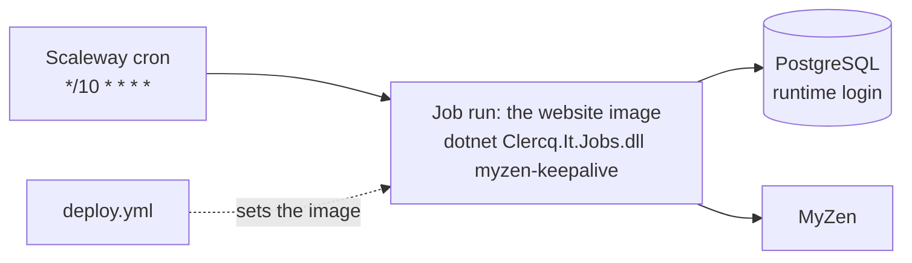

# Scheduled jobs

Timed work runs as **Scaleway Serverless Jobs** (issue #461). It is the same idea as a timer-triggered function in Azure: Scaleway starts a short-lived container on a cron schedule, the work runs, and the container stops. The website container is not involved, so it can stay asleep.

Today there is one job, `myzen-keepalive`: it touches the stored MyZen session every 10 minutes so MyZen keeps it ([MyZen](./myzen.md#keep-alive)).

## How it works

- The jobs are C# classes in `src/Clercq.It.Jobs`, a console app that is a composition root like `Clercq.It.ContentImport`. It is published into the website image, next to the API.
- `dotnet /app/api/Clercq.It.Jobs.dll <job-name>` runs one job and exits: **0** when it ran (or its feature flag is off), **1** when it failed, **2** for an unknown name.
- `infra/terraform/jobs.tf` has a `scheduled_jobs` map. Each entry becomes a `scaleway_job_definition` named `clercq-it-job-<job-name>` with its cron schedule (UTC) and timeout. Scaleway starts the command on that schedule.
- `deploy.yml` moves the job definitions to the deployed image after the smoke test passes (`.github/scripts/set-job-image.sh`), so a job runs the code of the version that is live. A failure there only warns: the jobs keep their previous image.



## What a job gets

| Input | Where it comes from |
| --- | --- |
| Database connection | Secret `db-runtime-connection` (the runtime login `clercqit_app`, rows only), as `ConnectionStrings__DefaultConnection` |
| `Database__CaCertificate` | The database's TLS certificate, a plain variable (public) |
| `FeatureFlags__<Name>` | The same flags as the website (`infra/terraform/feature_flags.tf`) |
| Job-specific secrets | The `secrets` map of its `scheduled_jobs` entry: environment variable name to a Secret Manager secret name. `myzen-keepalive` gets `MyZen__SessionKey` from `myzen-session-key`. |

Secrets are Secret Manager references, so their values are never plain job variables. A job gets only the secrets it names; `myzen-keepalive` never sees the MyZen password.

## Adding a job

1. **Write the class** in `src/Clercq.It.Jobs/Jobs/`, implementing `IScheduledJob`:

   ```csharp
   public sealed class CleanUpThingsJob(IThingRepository things) : IScheduledJob
   {
       public string Name => "clean-up-things";   // lowercase kebab-case
       public string? FeatureFlag => null;        // or a flag name to switch the job on and off

       public async Task<string> RunAsync(CancellationToken cancellationToken)
       {
           var removed = await things.RemoveOldAsync(cancellationToken);
           return $"removed {removed} things";    // one line for the run's log
       }
   }
   ```

   Throw to fail the run. Take what the job needs through the constructor (jobs are resolved in their own scope, like request handlers). Put the real logic in Application or Infrastructure behind an interface, as for the API, and keep the job a thin caller.
2. **Register it** in `src/Clercq.It.Jobs/JobsHost.cs`: `builder.Services.AddScheduledJob<CleanUpThingsJob>();`.
3. **Schedule it**: add an entry to `scheduled_jobs` in `infra/terraform/jobs.tf` with the same name, a cron `schedule` and a `timeout`, plus a `secrets` map if it needs more than the database.
4. **Test it**: unit-test the class with its dependencies mocked, like `tests/Clercq.It.Jobs.Tests`. `JobsHostTests` already checks that every registered job builds and has a kebab-case, unique name.
5. Update this page and any page that describes the job's feature.

Merging to `main` creates the job definition (`infra.yml`) and the next deploy points it at the live image.

## Running a job locally

With the same settings as the API (user secrets or environment variables):

```bash
ConnectionStrings__DefaultConnection="Host=localhost;Database=ClercqItDb;Username=clercq_user;Password=clercq_pass" \
FeatureFlags__MyZen=true MyZen__SessionKey=<the key> \
  dotnet run --project src/Clercq.It.Jobs -- myzen-keepalive
```

Run it with no job name to see the list of known jobs in the log. Locally nothing keeps MyZen alive by itself; run the command by hand, or reconnect when the session expires.

## Checking a job in production

Scaleway console → **Serverless → Jobs** → `clercq-it-job-<name>` → **Runs** shows each run with its status and logs (the one-line summary or the error). A job that failed shows a failed run; for `myzen-keepalive` the MyZen section also shows **last seen alive**.

## Cost

A run takes a few seconds of the smallest job size (120 mVCPU, 256 MB), and billing is per second, so `myzen-keepalive` (about 4,300 runs a month) is well within Scaleway's free monthly allowance, by the owner's estimate before the first bill. Check the first month's bill in the Scaleway console and correct this paragraph.

## Limits

- Cron schedules run in UTC and are not exact to the second.
- A run starts the image from scratch, so a job pays a few seconds of start-up each time. Very frequent or long work belongs elsewhere.
- Jobs and the website can touch the same data at once. The MyZen keep-alive saves the cookies MyZen refreshes, and a request that saves at the same moment can overwrite them with older but still valid ones.
