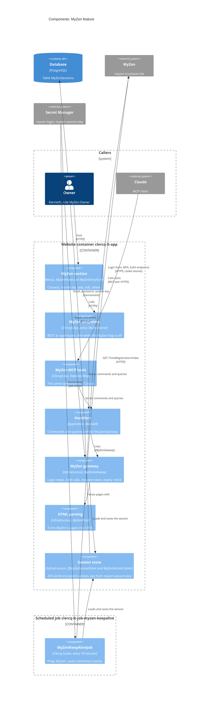
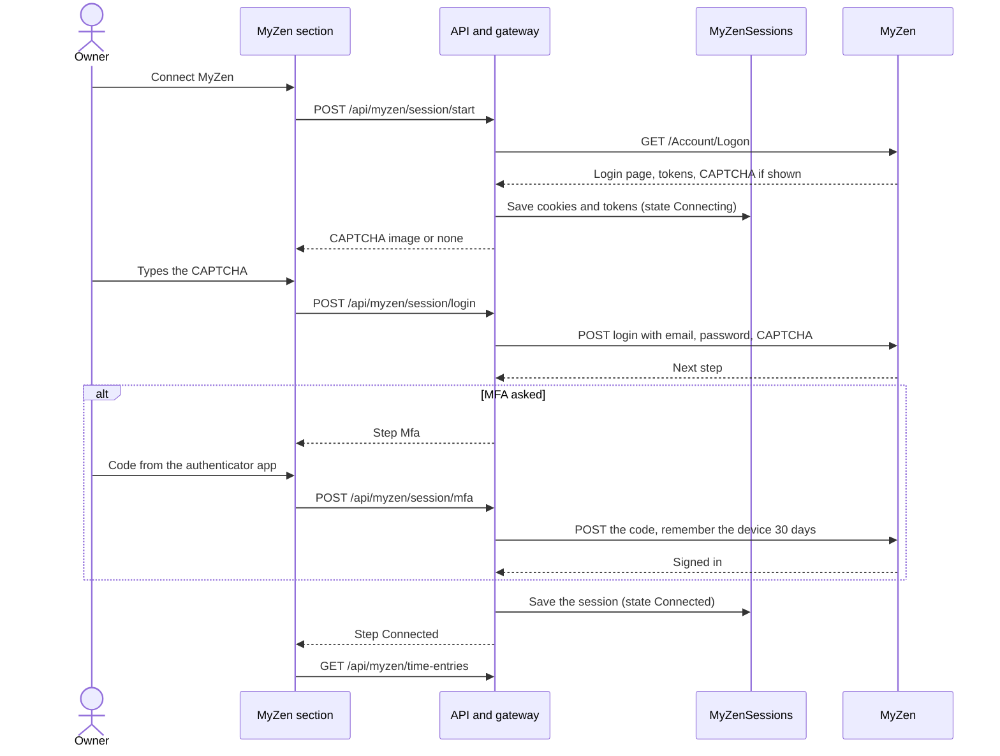
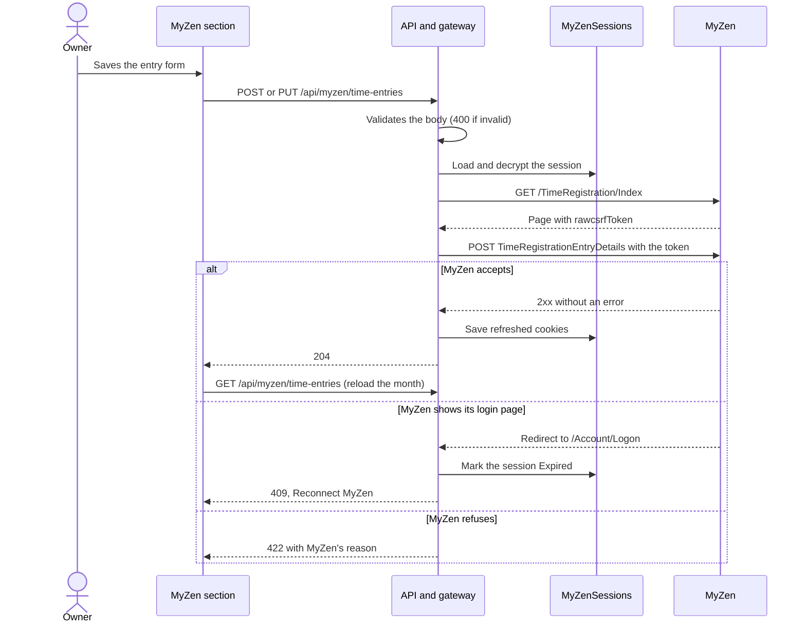
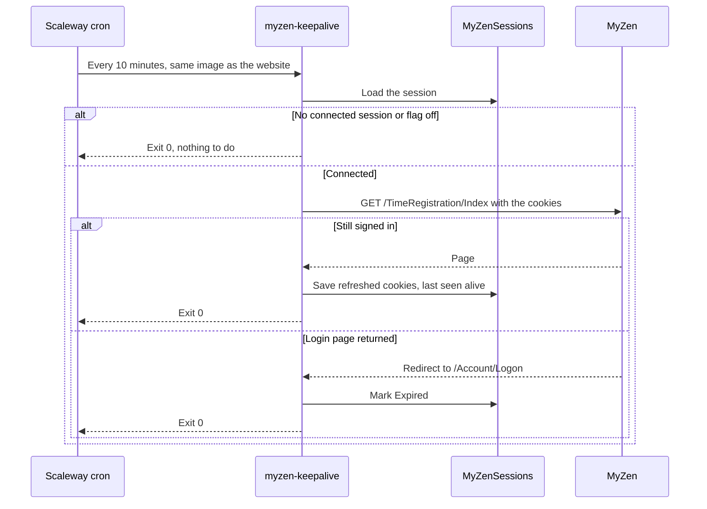
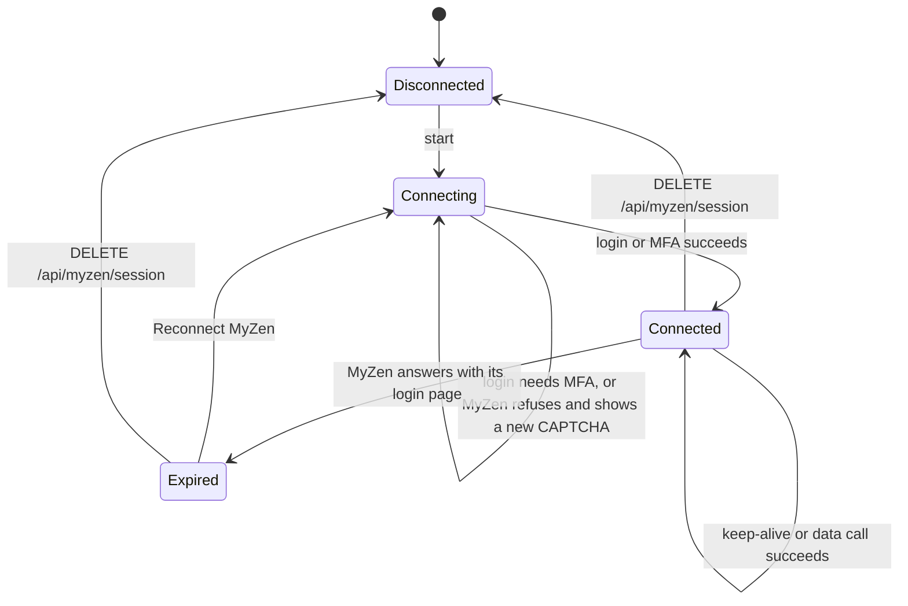

# MyZen integration

clercq.it can sign in to the owner's own [MyZen](https://myzen.trustteam.be) account (TrustTeam / Billit time registration), keep that session alive, read his projects and time entries, and add, edit and delete entries one at a time (issues #345 and #357).

## How it works

MyZen has no public API, so the site talks to it like MyZen's own web pages do: a cookie session, the login form, the MFA call and the AJAX endpoints. The requests were mapped from the owner's signed-in browser; the details are in the issue #345 comments.

MyZen's login has a CAPTCHA (sometimes) and MFA, so it cannot sign in unattended. The owner connects it from the admin dashboard:

1. **Admin → MyZen → Connect MyZen.** The API opens MyZen's login page and shows its CAPTCHA, if MyZen shows one.
2. **Sign in to MyZen.** The API signs in with the stored email and password and the CAPTCHA the owner typed. "Remember me" is always ticked.
3. **Verify.** When MyZen asks, the owner types the code from his authenticator app. "Remember this device for 30 days" is always ticked.
4. The session is **Connected**. The section shows this month's time entries; the arrows move to another month.

## Managing entries

In the MyZen section:

- **Add entry** opens a form: date, duration (`8:00`, or hours such as `7.5`), project, description and invoiced. The project comes from MyZen's own lookup: type two letters and pick one. The lookup also gives the customer the entry must carry; absence projects (Feestdag, Vakantie, Ziekte) have none.
- The pencil button opens an entry in the same form. The API reads the entry on its own first, so the form has its project and customer IDs.
- The bin button asks for confirmation, then deletes the entry in MyZen.

Each change writes one entry. Nothing writes entries in bulk.

Claude can do the same through the site's MCP server: the MyZen tools are listed in [MCP](./mcp.md#tools) and need `MyZen.Owner`. Connecting MyZen stays in this section.

When MyZen drops the session, the next keep-alive or data call notices (MyZen answers with its login page), marks it **Expired**, and the section offers **Reconnect MyZen**.

Only the authenticator-app MFA is supported. SMS and e-mail codes are not.

## Where things live

| Part | File |
| --- | --- |
| Gateway contract, DTOs, queries and commands | `src/Clercq.It.Application/Features/MyZen/` |
| MyZen client, HTML parsing, session store | `src/Clercq.It.Infrastructure/MyZen/` |
| Endpoints | `src/ClercqIt.Api/Features/MyZenEndpoints.cs` |
| Keep-alive job | `src/Clercq.It.Jobs/Jobs/MyZenKeepAliveJob.cs`, scheduled in `infra/terraform/jobs.tf` ([Scheduled jobs](./jobs.md)) |
| Error mapping (409, 422, 502) | `src/ClercqIt.Api/MyZenExceptionHandler.cs` |
| Admin section | `src/ClercqIt.Web/components/admin/MyZenPanel.tsx`, `src/ClercqIt.Web/components/admin/MyZenEntryForm.tsx`, `src/ClercqIt.Web/lib/api/myzenApi.ts` |

The HTML parsers (`MyZenHtml`) follow MyZen's current markup. When MyZen changes a page, `tests/ClercqIt.Api.Tests/MyZen/MyZenHtmlTests.cs` holds trimmed copies of each page (`MyZenPages.cs`) to update.

## Diagrams

The diagrams are [Mermaid](https://mermaid.js.org/), so GitHub renders them in place. The C4 view follows the [C4 model](https://c4model.com), like the ones in [Architecture](./architecture.md#c4-diagrams). A PR that changes how MyZen works updates them in the same PR.

### Components

Who talks to whom inside the MyZen feature. The website container and the keep-alive job run the same image and share the database.



### Connecting

MyZen's login has a CAPTCHA (sometimes) and MFA, so the owner connects it by hand once. The API signs in with the stored email and password.



### Changing a time entry

Each change writes one entry. The gateway opens the entry first, so an unknown ID changes nothing, and the section reloads the month afterwards.



### Keep-alive

The job runs on Scaleway on its own schedule, so it keeps running while the website container sleeps. See [Scheduled jobs](./jobs.md).



### Session states



## API

All endpoints need the `MyZen.Owner` role (policy `MyZenOwner`) and answer 404 while the `MyZen` feature flag is off.

| Endpoint | What it does |
| --- | --- |
| `GET /api/myzen/session` | State (`Disconnected`, `Connecting`, `Connected`, `Expired`), when it connected, when it was last seen alive |
| `POST /api/myzen/session/start` | Opens MyZen's login page; returns the CAPTCHA image, if any |
| `POST /api/myzen/session/login` | `{ "captcha": "..." }`; returns the next step (`Credentials`, `Mfa` or `Connected`) |
| `POST /api/myzen/session/mfa` | `{ "code": "123456" }`; returns the next step |
| `DELETE /api/myzen/session` | Forgets the session |
| `GET /api/myzen/projects` | All MyZen projects |
| `GET /api/myzen/time-entries?from=yyyy-MM-dd&to=yyyy-MM-dd` | Entries in the period (at most 93 days) |
| `GET /api/myzen/time-entries/{id}` | One entry, with its project and customer IDs |
| `GET /api/myzen/projects/search?q=...` | Projects matching `q` (2 to 50 characters), each with its `customerId` |
| `POST /api/myzen/time-entries` | Adds one entry (body below); 204 |
| `PUT /api/myzen/time-entries/{id}` | Replaces one entry (same body); 204, or 404 when MyZen has no such entry |
| `DELETE /api/myzen/time-entries/{id}` | Deletes one entry; 204, or 404 when MyZen has no such entry |

The entry body:

```json
{ "date": "2026-10-01", "durationMinutes": 480, "projectId": 20788, "customerId": 28245269, "description": "", "invoiced": false }
```

`durationMinutes` is 1 to 1440, `customerId` is `null` for a project without a customer, and `description` is at most 1000 characters. Invalid bodies get 400 and are never sent to MyZen.

A data call answers **409** when the session must be reconnected, **422** when MyZen refuses a change (the problem's `detail` is MyZen's reason, when it gives one) and **502** when MyZen cannot be reached, answers with an error status, or is not configured. The admin tab shows the problem's `detail` next to its own message (for example "Could not load the time entries. MyZen could not be reached."), and clears it once a month loads.

### MyZen calls behind the changes

| Change | MyZen request |
| --- | --- |
| Project search | `POST /Base/GetAutoSuggestValues` with `autoSuggestType=Projects`; the label carries the customer ID and name |
| Add or edit | `POST /TimeRegistration/TimeRegistrationEntryDetails` with `TimeRegistrationID` (empty for a new entry), `ProjectID`, `CustomerID`, `Date` (dd/MM/yyyy), `Duration` (seconds), `Description`, `Invoiced` |
| Delete | `POST /TimeRegistration/DeleteTimeRegistration` with `ID` |

Each call carries the request token from `/TimeRegistration/Index` and the `X-Requested-With` and `newui` headers MyZen's pages send. The token is `rawcsrfToken` in the page's `<script id="layoutmainconfig">` JSON: the HTML MyZen serves has no hidden `__RequestVerificationToken` input, MyZen's scripts only add those in the browser (issue #448). A hidden input is still read as a fallback. The time-entry list uses the same token. Before an edit or delete the gateway opens the entry, so an unknown ID changes nothing. MyZen's answer to a save is not documented: a JSON `Success: false` or a validation message in the returned HTML counts as refused, anything else with a 2xx status as saved. The first real save shows whether that holds; check the entry in MyZen after it.

## Session storage

The session (MyZen's cookies and the login page's tokens) is stored in the `MyZenSessions` table, encrypted with AES-GCM. The key is derived from the `myzen-session-key` secret, so a restarted or scaled-to-zero container can still read it. Nothing logs cookies, tokens, credentials or MyZen data. Rotating `myzen-session-key` makes the stored session unreadable; the owner then reconnects.

## Keep-alive

The `myzen-keepalive` [scheduled job](./jobs.md) opens MyZen's time registration page with the stored session every 10 minutes (`scheduled_jobs` in `infra/terraform/jobs.tf`) while the session is connected and the `MyZen` flag is on. It runs as a Scaleway Serverless Job from the website image, so it keeps running while the website container sleeps, and it saves the cookies MyZen refreshes. It reads the session with the database login and `MyZen__SessionKey`; it never gets the MyZen password. When MyZen answers with its login page the job marks the session **Expired**.

A run that cannot reach MyZen fails in the Scaleway console (**Serverless → Jobs → `clercq-it-job-myzen-keepalive` → Runs**) and tries again 10 minutes later. Check the session's **last seen alive** time in the MyZen section. Locally, run `dotnet run --project src/Clercq.It.Jobs -- myzen-keepalive` ([Scheduled jobs](./jobs.md#running-a-job-locally)).

## Configuration

| Setting | Production source |
| --- | --- |
| `MyZen__Email`, `MyZen__Password` | Scaleway secret `myzen-login` (type Username/password), created by the owner; Terraform reads it (`infra/terraform/secrets.tf`) |
| `MyZen__SessionKey` | Scaleway secret `/clercq-it/myzen-session-key`, generated by Terraform |
| `MyZen__BaseUrl` | Not set (default `https://myzen.trustteam.be`) |
| `FeatureFlags__MyZen` | `infra/terraform/feature_flags.tf` |

Locally, MyZen is off unless you set the flag and the `MyZen` settings with `dotnet user-secrets` on `src/ClercqIt.Api`. Never commit them.

## Owner setup (once)

1. Scaleway console → Secret Manager: the secret `myzen-login` holds the MyZen email and password (done 23 October 2026).
2. Cloud IAM → realm `clercqit` → **Realm roles → Create role** `MyZen.Owner`, add it to the `roles` client scope, and assign it to your user (see [Cloud IAM](./ciam.md#4-create-realm-roles)).
3. Sign in at `https://www.clercq.it/admin`, open **Administration > MyZen** in the menu and connect.

## Limits and risks

- MyZen's login page loads Cloudflare Turnstile. If it ever challenges a server-side sign-in, the connect flow fails and this design needs another approach.
- The integration reads MyZen's HTML, so a MyZen redesign can break it. The parsers skip rows they cannot read rather than fail.
- The save, delete and lookup answers were mapped from MyZen's pages, not tried against MyZen from the server. A change MyZen silently ignores would look saved; the section reloads the month after each change, so a missing entry shows there.
